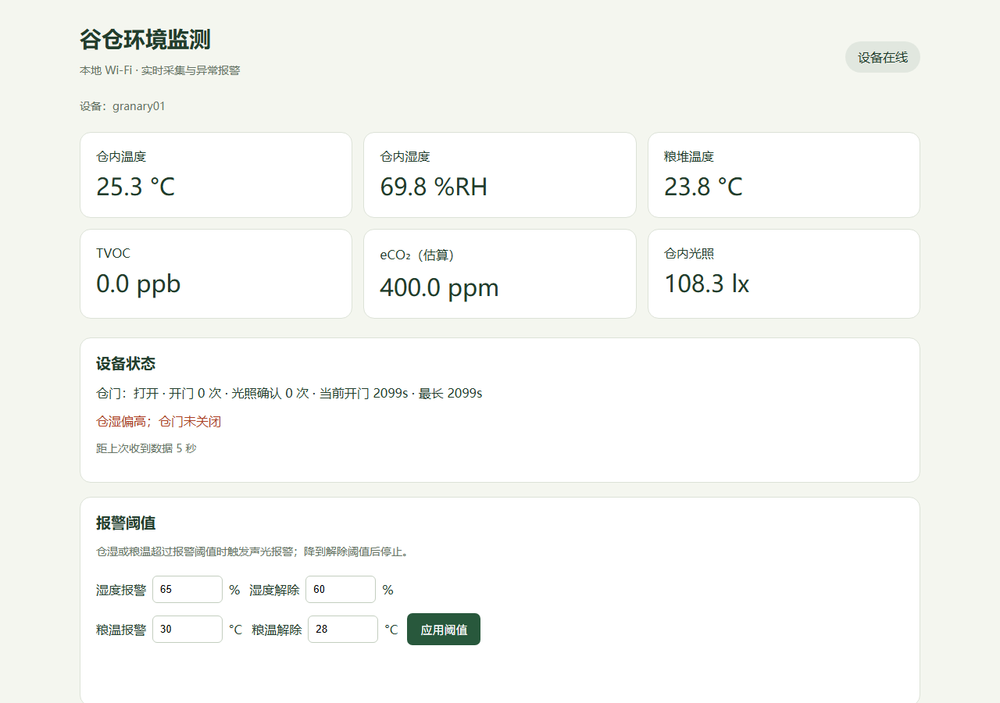

# ESP32-S3 谷仓环境监测与本地 MQTT

使用 Arduino IDE 打开 `firmware/granary/granary.ino`。ESP32-S3 采集传感器并执行本地报警，经 Wi-Fi 向电脑上的 Mosquitto 发布 JSON。电脑运行 Python 接收程序保存 SQLite 数据，并提供实时页面、最近一小时曲线及报警阈值设置。



这是可编译的原型实现；实际开发板、传感器接线、地址和执行器极性仍需上板确认。OLED 默认 SSD1306 128×64，显示英文标签。SGP30 的 eCO2 为估算指标。

## 1. 工程内容

- `firmware/granary/`：Arduino 主程序、采集、控制、OLED、MQTT。
- `local_server/`：本地接收服务与中文监测页面。
- `broker/mosquitto.conf`：带账号认证的局域网 Broker 配置。
- `tests/`：控制逻辑测试、接收端测试、真实 Mosquitto 合成数据链路测试。

## 2. Arduino IDE 安装依赖

开发板管理器安装 **esp32 by Espressif Systems**。本次使用 `3.3.10` 编译。

库管理器安装以下库，括号中为本次验证版本：

| 库 | 版本 |
|---|---|
| Adafruit SHT31 Library | 2.2.2 |
| Adafruit SGP30 Sensor | 2.0.3 |
| BH1750（Christopher Laws） | 1.3.0 |
| DallasTemperature | 4.0.6 |
| OneWire | 2.3.8 |
| Adafruit SSD1306 | 2.5.17 |
| Adafruit GFX Library | 1.12.6 |
| Adafruit BusIO | 1.17.4 |
| PubSubClient | 2.8.0 |
| ArduinoJson | 7.4.3 |

IDE 提示安装依赖时一并安装。`Wire`、`WiFi` 和 FreeRTOS 已随 ESP32 核心提供。

## 3. 填写 Wi-Fi 和 MQTT

复制 `firmware/granary/config_local.example.h` 为同目录 `config_local.h`，填写 Wi-Fi、电脑 IP、MQTT 用户名和密码。该私有文件被 Git 忽略。

在电脑运行 `ipconfig`，找到与 ESP32 所接 Wi-Fi 对应的 IPv4。例如电脑地址为 `192.168.1.100`，ESP32 的 `MQTT_HOST` 就填该地址；不能填 `127.0.0.1`。电脑与 ESP32 应处于允许设备互访的同一局域网；电脑 IP 改变后也需修改配置。ESP32-S3 使用2.4GHz Wi-Fi。

接线沿用原方案：

| GPIO | 设备 |
|---|---|
| 8 / 9 | I2C SDA / SCL |
| 4 | DS18B20 DATA，4.7kΩ上拉到3.3V，三线供电 |
| 5 | MC-38，另一端GND，内部上拉 |
| 7 | 有源蜂鸣器控制 |
| 15 / 16 | 绿LED / 红LED |

`config.h` 集中配置 GPIO、I2C 地址、有效电平和时序。默认 SHT30 `0x44`、BH1750 `0x23`、OLED `0x3C`；SGP30 固定 `0x58`。启动时串口自动扫描 I2C。

**GPIO7 的蜂鸣器已按低电平触发配置，空闲时输出高电平，报警时短暂拉低。**GPIO6 未分配，无需接负载。门关上为低电平时 `DOOR_CLOSED_LOW=true`，否则改为 `false`。第二个 OLED 默认关闭，实际装有不同地址 `0x3D` 的屏时，将 `SECOND_OLED_ENABLED=true`。没有 OLED 可将 `OLED_ENABLED=false`。

## 4. 启动电脑 MQTT Broker

先安装 [官方 Windows 版本的 Mosquitto](https://mosquitto.org/download/)。下面以安装在 `C:\Program Files\mosquitto` 为例；若安装位置不同，请修改 `$mosquittoDir`。

在 PowerShell 中进入下载后的项目根目录，再执行以下命令。配置中的密码文件使用相对路径，因此需从项目根目录启动 Broker。首次创建用户时会提示输入 MQTT 密码：

```powershell
$mosquittoDir = 'C:\Program Files\mosquitto'
& "$mosquittoDir\mosquitto_passwd.exe" -c .\broker\passwords granary
& "$mosquittoDir\mosquitto.exe" -c .\broker\mosquitto.conf
```

`-c` 会创建/覆盖密码文件，只在首次使用时运行；改已有用户密码时去掉 `-c`。把此密码填入 ESP32 的 `config_local.h` 和下面的接收端 `config.json`。Broker 控制台保持运行，用 Ctrl+C 退出。若1883已被另一实例占用，使用已有实例并核对配置。

Windows 防火墙需要允许 Mosquitto 的 TCP1883 入站，限定到可信专用网络/本地子网。配置面向局域网明文 MQTT，不用于公网暴露。数据由接收端 SQLite 保存，Broker 本身不提供历史曲线。

## 5. 下载到 ESP32-S3

Arduino IDE 选择 `ESP32S3 Dev Module`、对应串口：

- Flash Size：16MB（以实际 N16R8 硬件为准）。
- PSRAM：OPI PSRAM。
- 若使用芯片原生 USB：USB CDC On Boot 设为 Enabled，USB Mode 使用 Hardware CDC and JTAG。
- 若通过板载 USB-UART 下载/查看串口：按实际板型选择下载口与 CDC 设置，USB CDC On Boot 通常应 Disabled。
- 串口监视器：115200 baud。

代码不依赖 PSRAM 分配。编译用原生USB配置，不代表实际板型/下载口已验证。先只接主控和传感器确认采样，再按极性配置连接执行器。启动后应看到 `[I2C]` 地址、每5秒 `[DATA]` 和 MQTT 连接日志。空 Wi-Fi/Broker 配置不会阻止本地采集。

## 6. 启动本地监测页面

复制 `local_server/config.example.json` 为 `local_server/config.json`。Broker 和接收程序同在一台电脑时，这里的 `broker` 保持 `127.0.0.1`；用户名和密码填写前面创建的值，`device_id` 与固件保持一致。

另开 PowerShell，进入项目根目录：

```powershell
python -m venv .venv
& .\.venv\Scripts\python.exe -m pip install -r .\local_server\requirements.txt
& .\.venv\Scripts\python.exe .\local_server\server.py
```

电脑打开 **http://127.0.0.1:8080**。页面只在本机开放。连接后会显示读数、设备状态与曲线，页面超过15秒收不到新数据会标过期并禁用控制。接收端保留约24小时历史（按小时清理），页面查询最近一小时。接收端停机期间的数据不会补传。

## 7. MQTT 主题与指令

默认设备 `granary01`：

| 主题 | 方向 | 内容 |
|---|---|---|
| `granary/granary01/telemetry` | ESP32 → 电脑 | 每5秒实时 JSON，不 retained，QoS0 |
| `granary/granary01/status` | ESP32 → 电脑 | retained `online` / 遗嘱 `offline` |
| `granary/granary01/command` | 电脑 → ESP32 | JSON 报警阈值命令，发布时关闭 retained |
| `granary/granary01/ack` | ESP32 → 电脑 | 指令接收/拒绝信息，不 retained |

MQTTX 可以订阅 `granary/granary01/#` 检查链路。命令须带最新 telemetry 中的 `session`；每次设备重新连接 Broker 会生成新令牌，避免旧 retained 命令自动执行。本地页面自动填入令牌。

一次更新报警阈值需同时提交四项：

```json
{"session":"替换成最新16位会话令牌","thresholds":{"humidity_on":65,"humidity_off":60,"grain_on":30,"grain_off":28}}
```

报警阈值必须高于解除阈值。湿度限制0~100，粮温限制-20~60℃。修改只在 RAM 中有效，重启恢复默认。`accepted:true,state:queued` 表示命令已排队，实际状态以随后 telemetry 为准。

## 8. 报警规则与边界

- 仓湿 >65% 触发声光报警，降至60%后解除；粮温 >30℃触发声光报警，降至28℃后解除。
- 粮温比仓温高3℃以上持续10分钟触发局部升温报警；差值降至2℃后解除。无效采样中断持续判定。
- 门磁去抖50ms；开门30秒报警；开门次数独立计数，光照比关门时增加至少20lx且超过1.5倍再计一次光照确认事件。开机已开门不补计一次开门事件。
- SGP30 每秒测量，前15秒标预热、上传 `null`；收满此前10分钟有效数据才做趋势比较：超过均值1.8倍且增幅>100ppb。此阈值用于原型演示，未作为粮食品质判据验证。未实现长期基线掉电保存。
- SHT30/粮温每5秒、光照每2秒；DS18B20转换异步等待750ms。失败上传 `null`，10秒尝试重新初始化。未插模块不生成假数据。
- 启动30秒后，传感器故障也触发间歇蜂鸣器。故障位：1=SHT30，2=DS18B20，4=BH1750，8=SGP30，可相加。
- 网络在独立 FreeRTOS 任务运行；传感器和OLED在主任务共享I2C；MQTT不可用时本地报警继续。绿灯 MQTT 在线常亮，未联网时短闪；红灯报警闪烁，无报警时熄灭。
- 门磁统计与设备运行计时在重启后清零。阈值设置不写Flash。网页由电脑提供，ESP32不再运行原方案中的HTTP/AP网页。

## 9. 可复现验证

固件可按第 2 节和第 5 节在 Arduino IDE 中编译上传。安装第 6 节的 Python 依赖后，可在项目根目录运行接收端测试。MQTT 集成测试还需要本机安装 Mosquitto，并按实际安装路径修改 `$mosquittoDir`：

```powershell
$mosquittoDir = 'C:\Program Files\mosquitto'
& .\.venv\Scripts\python.exe -m unittest discover -s tests -p 'test_*.py' -v
& .\.venv\Scripts\python.exe .\tests\mqtt_integration.py --broker-exe "$mosquittoDir\mosquitto.exe"
```

`tests/control_test.cpp` 还可使用 C++17 编译器独立验证控制逻辑；编译器不包含在本仓库中。

集成测试仅在127.0.0.1:18883启动临时Broker，用模拟设备验证上传、入库、网页API、指令和离线状态，不连接实物；结束后清理测试进程和临时数据库。加 `--preview` 可保持模拟页面于 http://127.0.0.1:18080，Ctrl+C退出。

仍需上板验收：实际 I2C 地址、SHT/粮温合理性、SGP30运行时序、门磁极性、断网恢复、两个OLED地址、蜂鸣器有效电平和负载供电。编译与软件测试不能替代这些实测。

## 10. API 依据

- [Espressif Arduino I2C](https://docs.espressif.com/projects/arduino-esp32/en/latest/api/i2c.html)、[S3 GPIO限制](https://docs.espressif.com/projects/esp-idf/en/v5.0/esp32s3/api-reference/peripherals/gpio.html)
- [Adafruit SGP30](https://github.com/adafruit/Adafruit_SGP30)、[SHT31](https://github.com/adafruit/Adafruit_SHT31)、[BH1750](https://github.com/claws/BH1750)
- [DallasTemperature](https://github.com/milesburton/Arduino-Temperature-Control-Library)、[PubSubClient API](https://pubsubclient.knolleary.net/api)
- [Eclipse Paho Python](https://github.com/eclipse-paho/paho.mqtt.python)、[Mosquitto认证](https://mosquitto.org/documentation/authentication-methods/)
